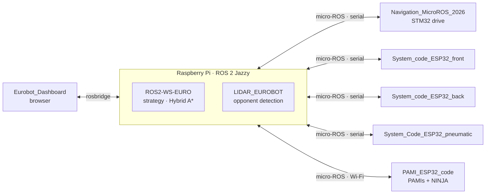

# 🤖 AEROBOTIX INSAT — EUROBOT 2026

Software, electronics, and mechanical design of the AEROBOTIX INSAT robots for the **EUROBOT 2026** international robotics competition.

🥇 **1st — Tunisian qualifications** &nbsp;·&nbsp; 🥈 **2nd — international accumulation phase** &nbsp;·&nbsp; 🌍 **5th — EUROBOT 2026 finals, France**

[▶ Watch the robot](https://www.youtube.com/watch?v=EC6gGIbOj7o&list=PLNhKoU2ZKSAGotMFKrfqBCY1hgt4LfQE8)

## The robots

- **Main robot.** A Raspberry Pi running ROS 2 Jazzy plans paths and runs the match strategy. An STM32 drives the wheels, three ESP32 boards run the pick-up arms and the suction system, and a lidar watches the opponent.
- **PAMIs.** Small autonomous ESP32 robots released near the end of the match. They receive their strategy from the main robot over Wi-Fi. **NINJA** is the PAMI with a suction gripper.

## Repositories

### Main robot — software

| Repository | What it is |
|---|---|
| [ROS2-WS-EURO](https://github.com/Eurobot-2026-Aerobotix/ROS2-WS-EURO) | ROS 2 workspace: strategy manager, task scheduler, Hybrid A* planner, device controllers |
| [Eurobot_Dashboard](https://github.com/Eurobot-2026-Aerobotix/Eurobot_Dashboard) | Web control room: strategy editor, live robot view over rosbridge, match start/stop, test panel |
| [LIDAR_EUROBOT](https://github.com/Eurobot-2026-Aerobotix/LIDAR_EUROBOT) | LD19 lidar: opponent tracking and collision prediction |

### Main robot — firmware

| Repository | Board | What it does |
|---|---|---|
| [Navigation_MicroROS_2026](https://github.com/Eurobot-2026-Aerobotix/Navigation_MicroROS_2026) | Nucleo-F446RE | Wheel speed control, odometry, trajectories, collision detection |
| [System_code_ESP32_front](https://github.com/Eurobot-2026-Aerobotix/System_code_ESP32_front) | ESP32 | Front arms: 4 N20 motors + 3 servos |
| [System_code_ESP32_back](https://github.com/Eurobot-2026-Aerobotix/System_code_ESP32_back) | ESP32 | Back arms: same firmware, back calibration |
| [System_Code_ESP32_pneumatic](https://github.com/Eurobot-2026-Aerobotix/System_Code_ESP32_pneumatic) | ESP32 | 2 vacuum pumps + 8 suction-cup valves |

### PAMIs

| Repository | What it is |
|---|---|
| [PAMI_ESP32_code](https://github.com/Eurobot-2026-Aerobotix/PAMI_ESP32_code) | PAMI and NINJA firmware (one branch per robot) |
| [NINJA_MECANIQUE](https://github.com/Eurobot-2026-Aerobotix/NINJA_MECANIQUE) | SolidWorks CAD of NINJA |

### Hardware and tools

| Repository | What it is |
|---|---|
| [PCBs](https://github.com/Eurobot-2026-Aerobotix/PCBs) | KiCad boards and Gerbers: arms, pneumatics, PAMI and NINJA shields, servo, power |
| [Pickaboo](https://github.com/Eurobot-2026-Aerobotix/Pickaboo) | Neural network that predicts whether a batch of game elements can be picked (experiment) |
| [Serial_plotter](https://github.com/Eurobot-2026-Aerobotix/Serial_plotter) | Real-time serial plotter for PID tuning |
| [D-MAX-t-l-guid-](https://github.com/Eurobot-2026-Aerobotix/D-MAX-t-l-guid-) | D-MAX, a PlayStation-controller remote-controlled robot |

## Built with

`ROS 2 Jazzy` · `micro-ROS` · `Python` · `C / C++` · `STM32 HAL + FreeRTOS` · `ESP32 Arduino + PlatformIO` · `rosbridge` · `Flask` · `KiCad` · `SolidWorks`

## About

[AEROBOTIX INSAT](https://github.com/Aerobotix-INSAT) is the robotics club of INSAT (Institut National des Sciences Appliquées et de Technologie), Tunis.

## Team

- Amine BENSAID
- Med Dhia Selmi
- Maram KHALSI
- Sellini Jihed
- Hatem Ben Salha
- Bouzidi Mahdi
- Hmadi Melek
